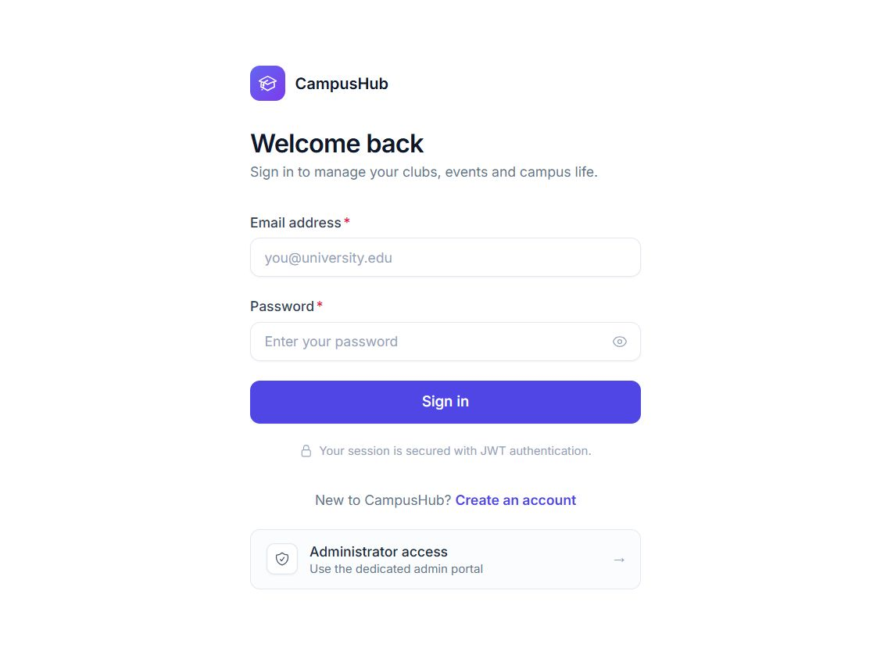
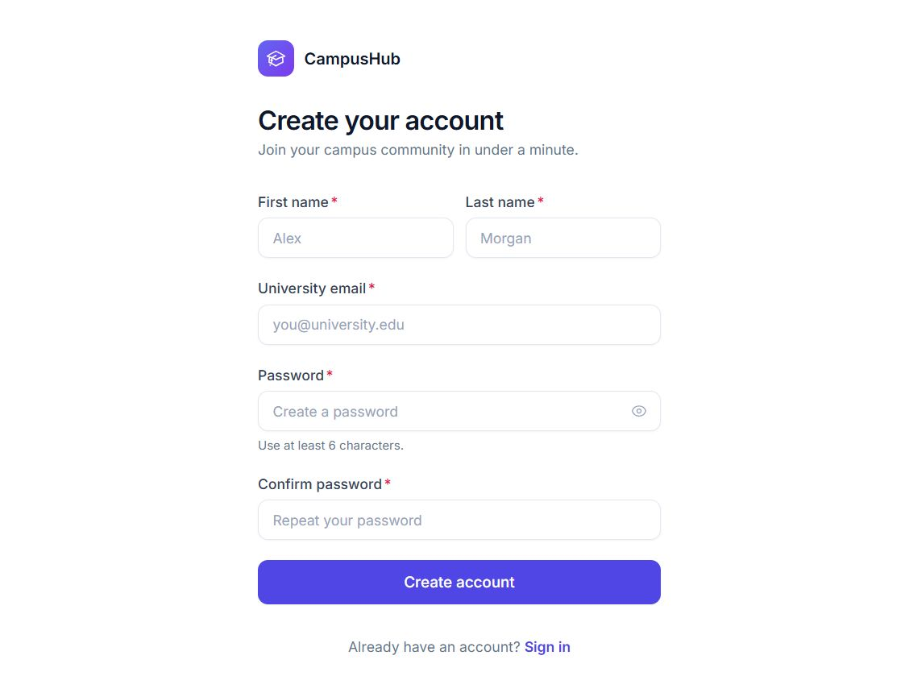

# University Club Management System

A full-stack university club platform for discovering clubs and events, managing memberships,
publishing announcements, collecting payments, sharing files, and handling feedback and safety
reports. The project is being modernized into a portfolio-ready application with a consistent
CampusHub design system.

## Current status

The main UI modernization and backend hardening pass is complete. Both applications compile
successfully. End-to-end runtime verification requires MongoDB and environment configuration,
which are not included in this repository.

## Live demo

Open the deployed application:

**[Launch CampusHub](https://university-club-management-system.vercel.app/login)**

| Screen | Link | What to explore |
|---|---|---|
| Sign in | [/login](https://university-club-management-system.vercel.app/login) | Member authentication and session handling |
| Create account | [/register](https://university-club-management-system.vercel.app/register) | Validated account registration |
| Browse clubs | [/browse-clubs](https://university-club-management-system.vercel.app/browse-clubs) | Public club discovery |
| Browse events | [/browse-events](https://university-club-management-system.vercel.app/browse-events) | Event discovery and registration |
| Admin portal | [/admin](https://university-club-management-system.vercel.app/admin) | Moderation and administration tools |

> The production URL is recommended for testing. Vercel preview URLs may require Vercel
> authentication depending on the project’s deployment protection settings.

## Testing the deployed application

The deployed database is not seeded with public demo credentials. Use **Create an account** on
the registration page to create a test user, then explore the member workspace. Administrator
access requires an account with the appropriate role in the deployed database and is intentionally
not documented with a public password.

For a complete portfolio demonstration, connect the backend to a private MongoDB instance and
populate it with approved clubs, events and announcements before sharing administrator access.

## Product preview

These screenshots are captured from the deployed CampusHub application rather than recreated
mockups. Use the live links in the [Live demo](#live-demo) section to interact with the current
deployment.

| Sign in | Create account |
|---|---|
|  |  |

### Interface snippets

```text
Member authentication
  CampusHub → Welcome back → Sign in
  CampusHub → Create your account → Register

Shared experience
  App shell → Dashboard → Clubs → Events → Payments → Notifications → Profile

Administration
  Admin portal → Overview → Users → Clubs → Payments → Feedback → Reports
```

### Member workspace

```text
CampusHub
├── Dashboard       Overview, upcoming events and announcements
├── Clubs           Discover, join and manage campus communities
├── Events          Browse, register and track attendance
├── Payments        Submit and review event payments
├── Notifications   Keep up with club and event activity
└── Profile         Manage identity, preferences and theme
```

### Administration workspace

```text
Admin workspace
├── Overview        Platform activity and operational metrics
├── Users           Search, review and manage accounts
├── Clubs           Approve clubs and review membership activity
├── Payments        Review payment submissions
├── Feedback        Moderate ratings and respond to members
└── Reports         Review safety reports and take action
```

The interface uses a responsive application shell, indigo action accents, neutral surfaces,
accessible form controls, empty states, loading skeletons and light/dark themes.

## Features

- JWT authentication with member and admin experiences
- Club creation, approval, membership applications and member management
- Event creation, registration, payments and event management
- Announcements and notifications
- Feedback and rating workflows with moderation
- Content reports with attachments and admin review
- File uploads, gallery browsing and downloads
- Responsive light/dark interface with shared app shell
- Admin dashboards for users, clubs, payments, announcements, feedback and reports

## Stack

### Frontend

- React 19 with Create React App
- React Router
- Tailwind CSS and Heroicons
- Material UI remains for legacy file/feedback widgets
- Axios with a shared authenticated API client

### Backend

- NestJS 11 and TypeScript
- MongoDB with Mongoose
- JWT authentication and Socket.IO notifications
- Class-validator DTO validation
- Multer-based file uploads

## Project structure

```text
backend/   NestJS API
frontend/  React client
docs/      Audit, modernization plan and upgrade notes
```

## Setup

Install dependencies in both applications:

```bash
cd backend && npm install
cd ../frontend && npm install
```

Create environment files from the examples:

```bash
copy backend\.env.example backend\.env
copy frontend\.env.example frontend\.env
```

Set valid local values for MongoDB, JWT and any upload provider before starting the services.
Never commit `.env` files or real credentials.

Run the applications in separate terminals:

```bash
cd backend && npm run start:dev
cd frontend && npm start
```

The frontend defaults to `http://localhost:3000` and the API defaults to `http://localhost:8000`.
Set `REACT_APP_API_URL` if the API is hosted elsewhere.

## Verification commands

```bash
cd frontend && npm run build
cd backend && npm run build
```

Both commands currently pass. Browser smoke testing and integration tests should be run with a
seeded MongoDB instance before deployment.

## Security note

Cloudinary credentials were previously present in repository history. They must be rotated at the
provider before any deployment, even though the example file now contains placeholders.

## Documentation

- [UI audit and modernization plan](docs/UI_AUDIT_AND_PLAN.md)
- [UI upgrade notes](docs/UI_UPGRADE_NOTES.md)
